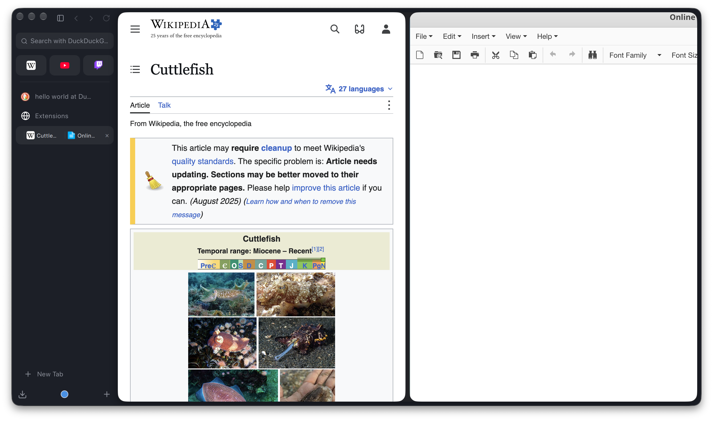
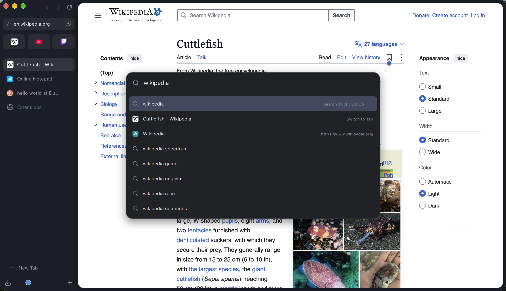
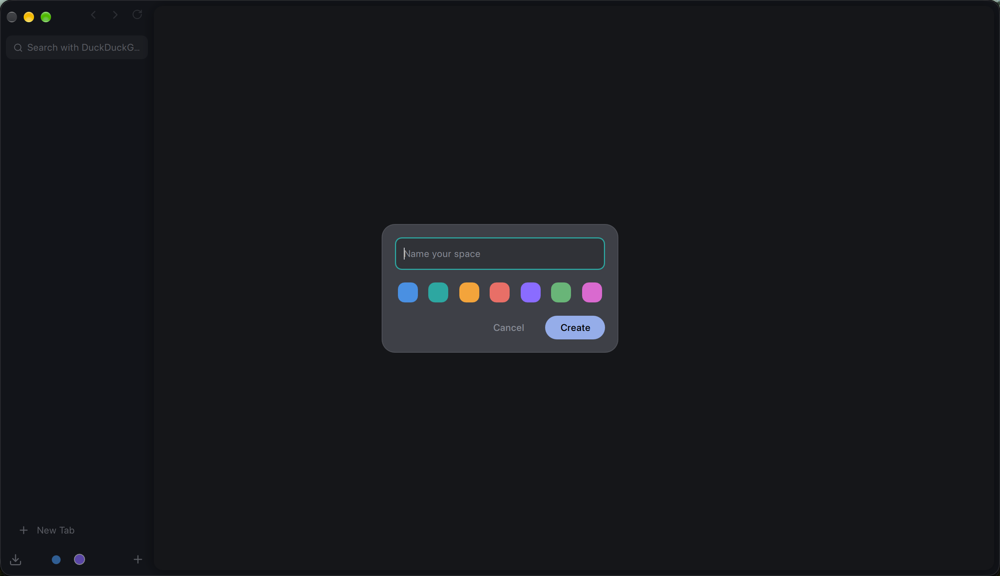
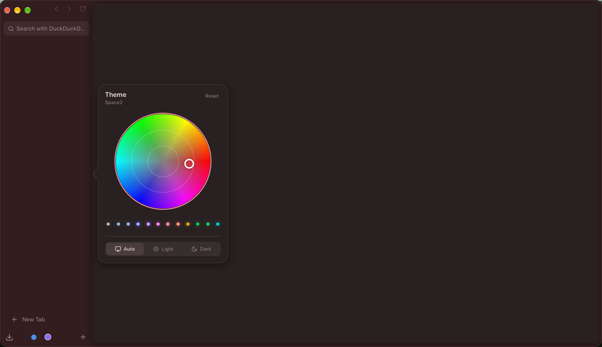
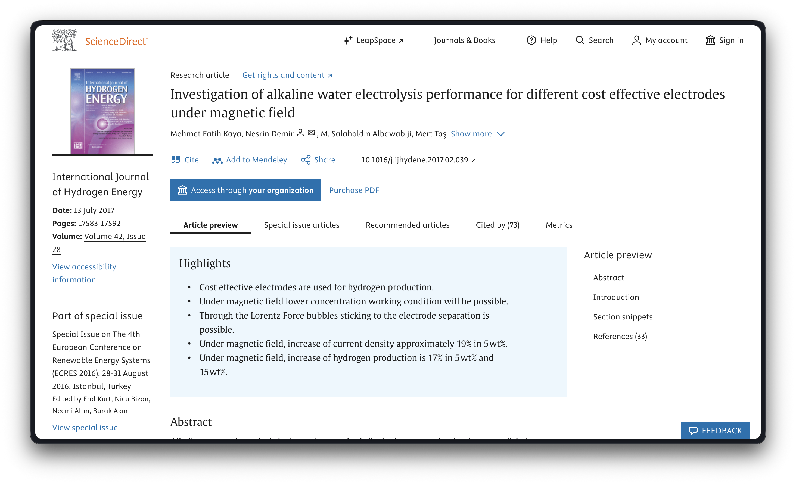
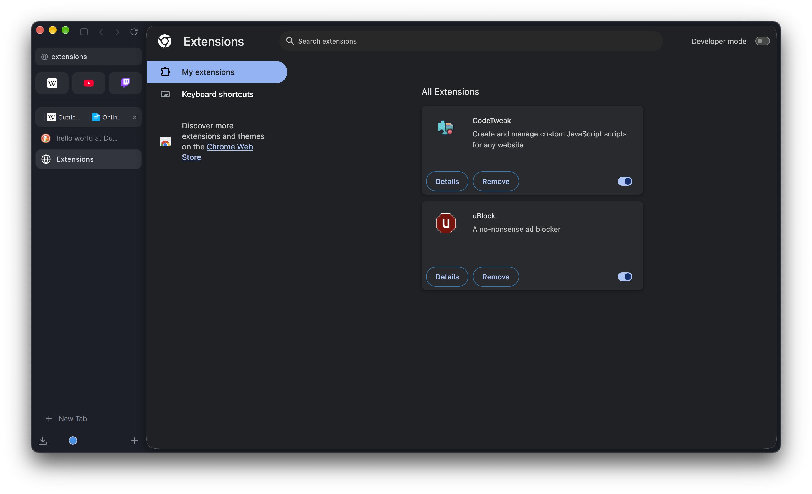

<p align="center">
  
</p>

# Illuminate

Illuminate is a browser built with Qt 6 and Chromium Embedded Framework (CEF). 

## Features

- Multi-tab browsing, split tabs side-by-side, bookmarks, and browsing spaces
- Quick command bar overlay and keyboard shortcuts
- Chromium extensions support and internal memory usage tools
- Compatable with MacOS, Linux, and Windows

### Split View


### Command Bar


### Spaces


### Themes


### Sidebar & Folders


### Focus Mode


### Extensions


## Requirements

- CMake 3.16+
- Qt 6.8+ with Core, Gui, Network, Qml, Quick, Quick Controls 2, Widgets, PrintSupport, and Sql
- CEF binary distribution matching your OS and architecture
- C++20 compiler and platform build tools (Xcode on macOS, Visual Studio on Windows, or a C++ toolchain on Linux)

## Build

```sh
./install-cef.sh
```

Set `CEF_ROOT` to the printed installation path, then build and run:

```sh
./build.sh
```

## Tests

```sh
./build.sh --test
```

## Todo list
- global system for popups

## Contributing

Contributions welcome: bug fixes, tests, documentation, and focused feature work. Before starting large changes, open an issue to discuss scope.

1. Fork repository and create a focused branch.
2. Build locally with `./build.sh --dev`.
3. Run `./build.sh --test` and include relevant test coverage.
4. Open a pull request with problem, change, test results, and screenshots for UI changes.

Keep changes focused and follow existing C++/QML conventions. Report bugs and propose work through GitHub Issues. Do not include secrets, personal browser data, or generated build artifacts in commits.

## License

Illuminate is distributed under the [MIT License](LICENSE).
